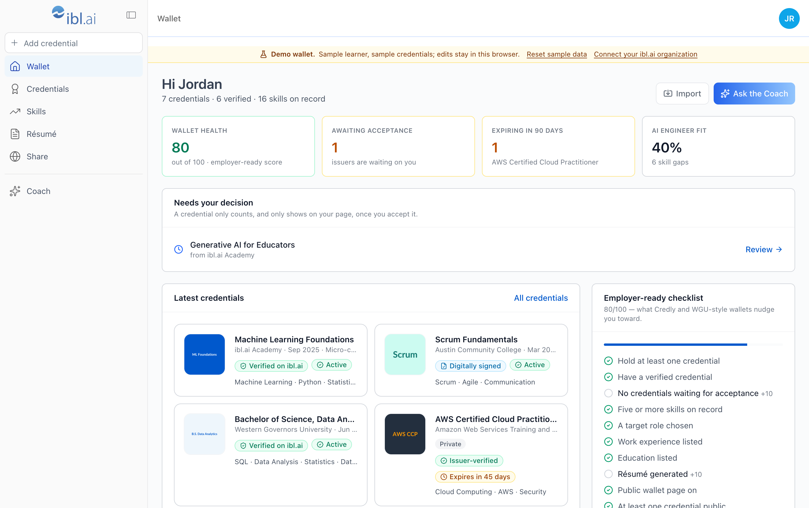
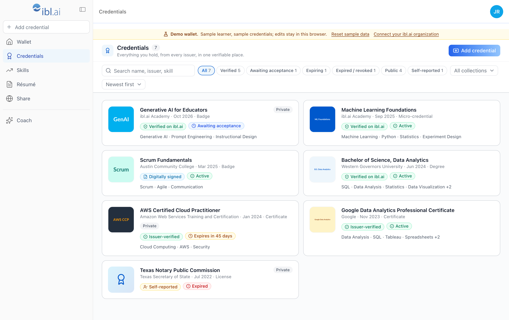
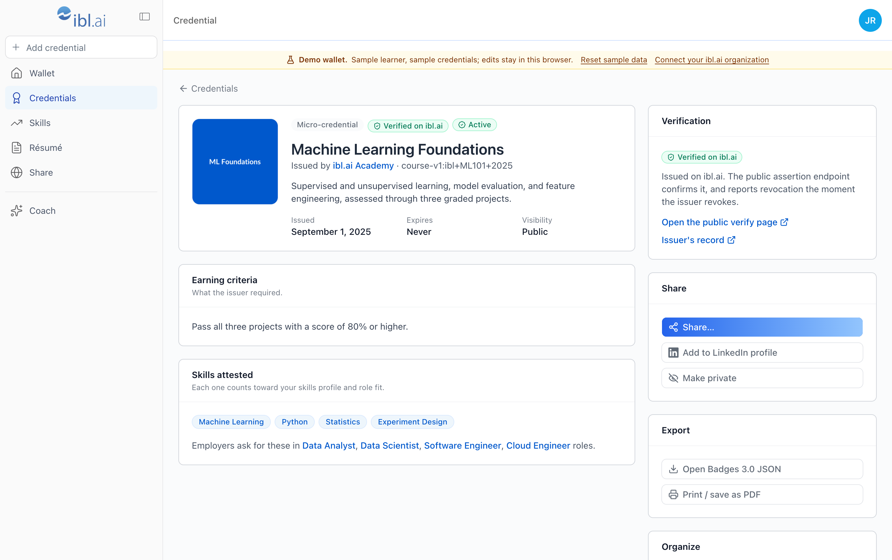
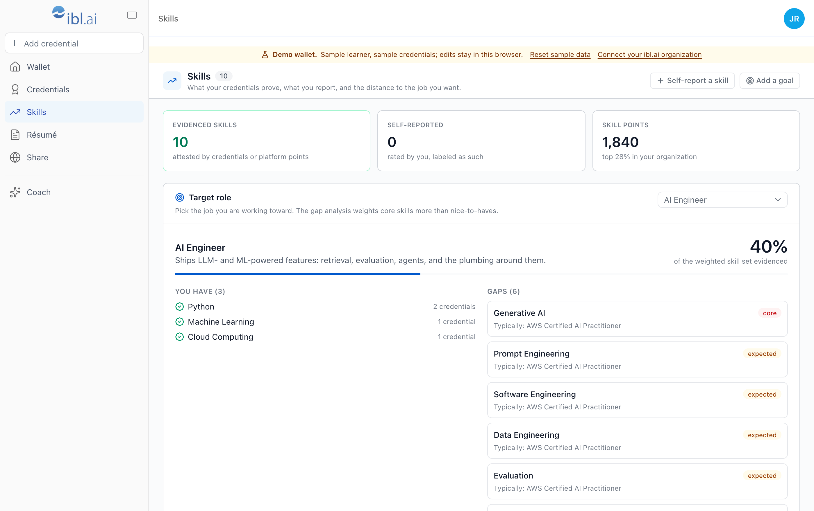
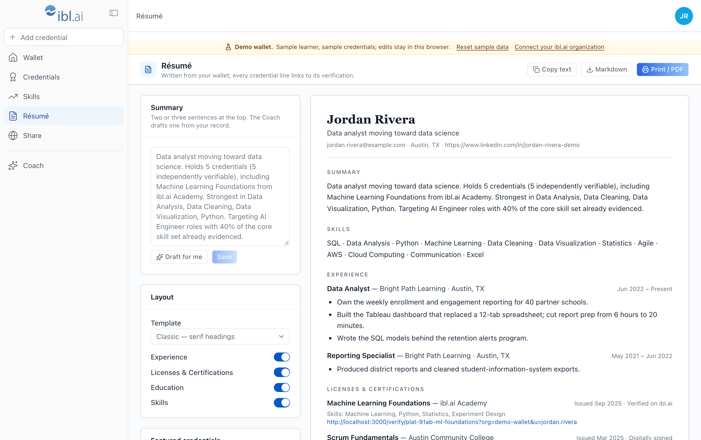
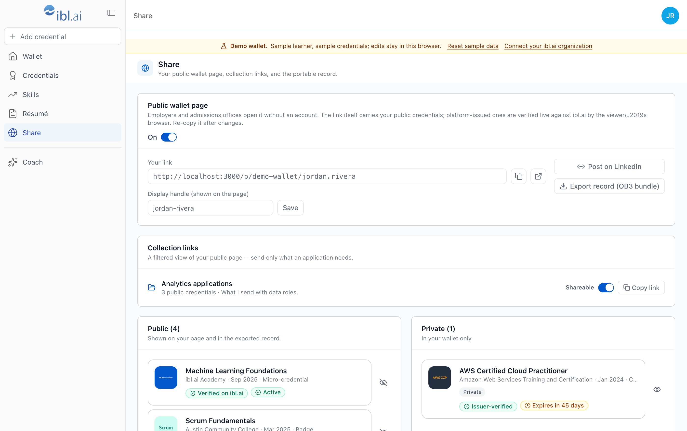
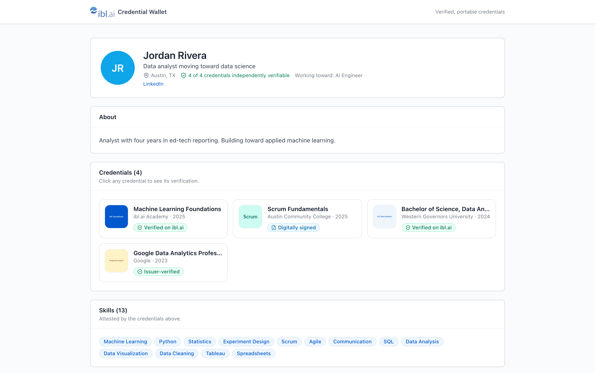
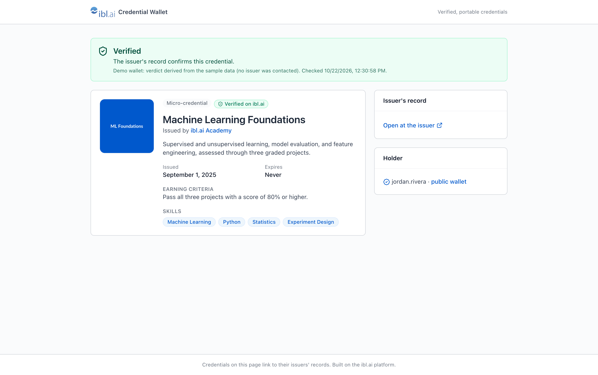

<div align="center">

<a href="https://ibl.ai"></a>

# ibl.ai/wallet

**The open-source credential wallet for learners — your credentials, skills and résumé, verified, portable, and yours.**

One place for everything you have earned: the badges and certificates your organization issues on ibl.ai, the Open Badges and Credly badges you bring from elsewhere, and the licenses and degrees you hold on paper. A skills profile that maps them to the job you want. A résumé written from the record. A share link an employer can verify without trusting you. Built on the [ibl.ai](https://ibl.ai) platform with [iblai/vibe](https://github.com/iblai/vibe).

[](https://ibl.ai/join)
[](https://github.com/iblai/vibe)
[](LICENSE)
[](https://ibl.ai)
[](https://nextjs.org)
[](https://www.imsglobal.org/spec/ob/v3p0)

[Why](#why-iblaiwallet) · [What a learner gets](#what-a-learner-gets) · [Verification](#verification-what-an-employer-sees) · [Skills and roles](#skills-and-roles) · [Quick start](#quick-start) · [Configuration](#configuration) · [Architecture](#architecture)

</div>

---

## Why ibl.ai/wallet

|                                    |                                                                                                                                                                                                                                                                                                                       |
| ---------------------------------- | --------------------------------------------------------------------------------------------------------------------------------------------------------------------------------------------------------------------------------------------------------------------------------------------------------------------- |
| 🎓 **Learner-owned record**        | The wallet belongs to the person, not the issuer. Everything they add lives in their own ibl.ai profile and metadata and follows them across every organization they belong to — the idea behind WGU's Achievement Wallet and the Learning and Employment Record, on the ibl.ai platform.                             |
| ✅ **Verified, not screenshotted** | Credentials issued on ibl.ai verify live against the platform's public assertion endpoint; a revoked one disappears from every share link on its own. Imported Open Badges carry the issuer's link. Self-reported records say so, everywhere. The verification page is what Credly made employers expect.             |
| 🧭 **Skills → jobs**               | Every credential attests skills; every skill maps to roles. Pick a target role and see the weighted gap, what typically closes it, and illustrative labor-market context — the "labor market insights" Credly attaches to a badge, on the learner's own data.                                                         |
| 📄 **A résumé from the record**    | Summary, skills, experience, licenses & certifications and education, written from the wallet; every credential line links to its verification. Print to PDF or download Markdown; Draft for me writes the summary with the platform's AI.                                                                            |
| 🤖 **A coach, not a help page**    | The platform's ibl.ai agent (memory, RAG, guardrails tuned in the Agentic OS): the one an admin picks on `/setup`, or else the platform's default agent.                                                                                                                                                              |
| 🔓 **No server, no secrets**       | Nothing runs on a server of ours and no API token is stored. The browser talks to ibl.ai as the signed-in user; share links are self-contained and verified by the viewer's browser. Sign-in, organizations, profile, notifications, analytics and admin come from the platform, through the same shell as os.ibl.ai. |

---

## What a learner gets

**Wallet** — the record at a glance: an employer-ready health score (the checklist Credly and WGU-style wallets nudge toward), credentials awaiting acceptance, credentials expiring within 90 days, the latest ones, and the distance to the target role.

**Credentials** — every credential from every origin, normalized to one shape:

| Origin       | How it arrives                                                                                               | Verification level                                              |
| ------------ | ------------------------------------------------------------------------------------------------------------ | --------------------------------------------------------------- |
| **Platform** | Issued by the organization on ibl.ai; appears the moment it is issued, pending until the learner accepts it  | **Verified on ibl.ai** — public assertion endpoint, live        |
| **Imported** | A badge link (Credly, Badgr, Canvas Credentials, any hosted Open Badge) or pasted Open Badges 2.0 / 3.0 JSON | **Issuer-verified** (hosted) · **Digitally signed** (OB3 proof) |
| **Self**     | Typed in by the learner, optionally with a link to a scan                                                    | **Self-reported** — labeled as such wherever it is shown        |

Each credential page shows the badge, issuer, earning criteria, evidence and skills; **accept / decline** (the Credly flow); **public / private**; collections ("Analytics applications", "Teaching license renewal"); and share actions — **Add to LinkedIn profile** (the same deep link Credly builds), a verify link, a ready-to-paste blurb, email, X, an embed snippet — plus export as Open Badges 3.0 JSON or the original issuer JSON, and print.

**Skills** — evidenced skills (from accepted credentials and ibl.ai skill points), self-reported skills with a 1–5 level, and goals; a target role with the weighted gap analysis; other roles the wallet already fits.

**Résumé** — classic, modern or compact; sections on/off; choose which credentials to feature; summary drafted from the record by the platform's AI, and editable.

**Share** — a public wallet page link, collection links (send only what an application needs), per-credential public/private, and the whole record as an Open Badges 3.0 bundle (a Verifiable Presentation without proof — the LER shape other wallets read).

**Coach** — a chat (the SDK `<Chat>`) with the platform's agent: the one an admin picks on `/setup` (`MentorSelectionGrid`, or a new one from `CreateAgentModal`), or else the platform's default agent.

**Profile** — the SDK's full ibl.ai profile (basic, social, education with its credentials and skills sub-tabs, experience with résumé upload, memory, history, privacy, security), reached from the avatar menu as in the OS.

**Admin mode** (organization admins, the OS's User/Admin switch) — Analytics (overview, users, topics, transcripts, financial, reports) in the sidebar, and the OS footer cluster: Credentials (what the organization can issue and what it has issued), Notifications, Invites, Management, Integrations, Monetization, Advanced, Support — each opening the platform's own organization sheets in place.

---

## Verification: what an employer sees

A share link is self-contained. Its URL fragment — never sent to any server — carries the holder's public-safe snapshot: the ids of platform-issued credentials, and summaries of imported and self-reported ones. The viewer's browser then does the checking:

```
/p/<org>/<username>#d=…        the public wallet page
/verify/<id>?org=…&u=…[#c=…]   one credential's verification page
```

| The credential is…  | The viewer's browser…                                                                           | Verdict shown                                     |
| ------------------- | ----------------------------------------------------------------------------------------------- | ------------------------------------------------- |
| issued on ibl.ai    | calls `GET /dm/api/credentials/public/assertions/{id}/` (no auth) and shows the issuer's record | Verified · Revoked (with reason) · Expired        |
| a hosted Open Badge | re-fetches the issuer's JSON when the issuer allows browser reads and compares name + issuer    | Verified · Does not match · issuer link otherwise |
| self-reported       | shows the holder's copy from the link                                                           | Self-reported                                     |

Because the snapshot is in the link, the holder re-copies it from **Share** after changing what is public — the page says so.

---

## Skills and roles

[`lib/wallet/market.ts`](lib/wallet/market.ts) is the market layer: twelve roles (data analyst, data scientist, software engineer, cloud engineer, cybersecurity analyst, project and product manager, UX designer, registered nurse, K-12 teacher, instructional designer, AI engineer) with weighted skill sets (core / expected / nice to have), a skill-alias table so "JS", "JavaScript" and "ECMAScript" are one skill, and illustrative US figures (median pay, range, ten-year growth, demand, typical credentials) — labeled illustrative in the UI. `gapAnalysis()` weights coverage by importance and names what typically closes each gap. Swap the file for a live taxonomy (Lightcast, O\*NET, your organization's skills library) without touching the pages.

---

## Screenshots

Captured from the bundled sample wallet (`NEXT_PUBLIC_WALLET_DEMO=true`): one learner with a degree, platform-issued micro-credentials, a Credly badge, a certification about to expire, a pending badge and a self-reported license.

<div align="center">

**Wallet — health score, what needs attention, the latest credentials, the target-role fit**



**Credentials — every origin, filtered**



**A credential — accept, verify, share, export**



**Skills — target role, weighted gap, market context**



**Résumé — written from the record, every credential line verifiable**



**Share — the public page and collection links**



**What an employer sees**





</div>

---

## Quick start

```bash
git clone https://github.com/iblai/wallet.git
cd wallet
pnpm install --ignore-scripts
cp .env.example .env.local
pnpm dev
```

Open [http://localhost:3000](http://localhost:3000). You are sent to [login.iblai.app](https://login.iblai.app) to sign in — any ibl.ai account, any organization — and come back to your wallet in your default organization; the avatar menu switches between the organizations you belong to, exactly as os.ibl.ai does. `http://localhost:3000` must be an allowed redirect origin of the organization you sign in to.

New to ibl.ai? [ibl.ai/join](https://ibl.ai/join) creates your account and your organization. Issuing credentials is done by organization admins in the Agentic OS (Credentials) or through the [credentials API](https://github.com/iblai/vibe/blob/main/skills/content/iblai-api-credential/SKILL.md); learners accept them here.

**No organization yet?** `NEXT_PUBLIC_WALLET_DEMO=true pnpm dev` runs the sample wallet with no platform calls; edits stay in the browser. `localStorage.demo_admin = "1"` previews Admin mode on it.

**Using [Claude Code](https://claude.ai/claude-code) or another coding agent?** Read [`AGENTS.md`](AGENTS.md) first; the [iblai/vibe](https://github.com/iblai/vibe) skills (`npx skills add iblai/vibe --all`) document every platform surface this app uses.

### Scripts

| Command                            | What it does                                                                                            |
| ---------------------------------- | ------------------------------------------------------------------------------------------------------- |
| `pnpm dev`                         | Dev server on port 3000                                                                                 |
| `pnpm build` / `pnpm start`        | Production build / serve it                                                                             |
| `pnpm typecheck` · `lint` · `test` | TypeScript · oxlint · Vitest                                                                            |
| `pnpm test:e2e`                    | Playwright journeys (needs `e2e/.env.development`)                                                      |
| `pnpm format` · `format:check`     | oxfmt (the CI gate)                                                                                     |
| `pnpm test:coverage`               | Vitest with the coverage thresholds (CI)                                                                |
| `pnpm release`                     | release-it: version from the commits, CHANGELOG, tag, GitHub Release (CI runs it on every push to main) |

---

## Configuration

All configuration is `NEXT_PUBLIC_*`, read in the browser, and optional against hosted `iblai.app`; defaults live in [`lib/iblai/config.ts`](lib/iblai/config.ts). There is no server-side configuration and no secret.

| Variable                       | Default                     | Description                                                                         |
| ------------------------------ | --------------------------- | ----------------------------------------------------------------------------------- |
| `NEXT_PUBLIC_MAIN_TENANT_KEY`  | `main` (in code)            | The community organization — only the fallback before anyone has signed in          |
| `NEXT_PUBLIC_WALLET_DEMO`      | `false`                     | `true` runs the bundled sample wallet with no platform calls                        |
| `NEXT_PUBLIC_DEFAULT_AGENT_ID` | —                           | Pin the Coach's agent instead of reading it from the platform's metadata (`/setup`) |
| `NEXT_PUBLIC_API_BASE_URL`     | `https://api.iblai.app`     | Consolidated API; `/dm`, `/lms`, `/axd` derive from it                              |
| `NEXT_PUBLIC_AUTH_URL`         | `https://login.iblai.app`   | The hosted Auth SPA                                                                 |
| `NEXT_PUBLIC_BASE_WS_URL`      | `wss://asgi.data.iblai.app` | Chat websocket for the Coach; its HTTPS origin serves the Draft for me completion   |
| `NEXT_PUBLIC_SUPPORT_EMAIL`    | `support@ibl.ai`            | Shown in chat footers and error toasts                                              |

---

## Deployment

ibl.ai/wallet is a static-friendly Next.js front end for the ibl.ai platform: no API routes, no database, no secrets. Deploy it anywhere Next.js runs, or through the platform's hosting (`/iblai-vibe-ops-deploy` in [iblai/vibe](https://github.com/iblai/vibe)):

```bash
pnpm build && PORT=3000 pnpm start
```

On hosted iblai.app no origin registration is needed: the sign-in site accepts any `redirect-to` host. A self-hosted platform may allowlist origins; register every origin the app runs on there. The only server piece is vibe-starter's nonce-based Content-Security-Policy proxy (`proxy.ts`), which carries no data.

### Vercel

Import the repository; `vercel.json` pins the Next.js preset and the build is the regular output (standalone is for a container host). Project settings:

- Environment: `ENABLE_EXPERIMENTAL_COREPACK=1` (pnpm 12 from `packageManager`), `NEXT_PUBLIC_MAIN_TENANT_KEY=main`, and optionally `NEXT_PUBLIC_SUPPORT_EMAIL`, `NEXT_PUBLIC_DEFAULT_AGENT_ID`. Leave `NEXT_PUBLIC_WALLET_DEMO` unset; a separate project with it set to `true` serves the demo.
- Domain: add it to the project. The platform's `custom-domains` lookup for the host should answer `{}` (no platform pinned), which keeps the multi-organization sign-in.
- After the first deploy: sign in, check the console shows no token lines, then open a public wallet link and a verify link cold.

### Release

Every push to `main` runs release-it in CI (`.github/workflows/release.yml`): the version and `CHANGELOG.md` come from the conventional commit subjects since the last `v*` tag, and the release commit, tag and GitHub Release are pushed by the bot. Publish the baseline tag once by hand: `git tag v0.1.0 && git push origin v0.1.0`.

---

## Architecture

```
wallet/
├── app/
│   ├── layout.tsx                        # root: providers (data layer, AuthProvider, TenantProvider)
│   ├── (app)/                            # the signed-in wallet — the OS shell
│   │   ├── layout.tsx                    # SidebarProvider → PlatformSidebar + SidebarInset (PlatformNavbar)
│   │   ├── page.tsx                      # Wallet home
│   │   ├── credentials/                  # list · [id] detail · import (link · JSON · manual · your platforms)
│   │   ├── skills/ · resume/ · share/    # skills + gap analysis · résumé builder · public page + export
│   │   ├── coach/                        # SDK <Chat> with the platform's agent
│   │   ├── profile/ · agents/ · account/ · notifications/
│   │   └── admin/                        # credentials (issue side) · analytics · users · billing · memory · organization
│   ├── (public)/p/[org]/[username]/      # public wallet page — no session, verified in the viewer's browser
│   ├── (public)/verify/[id]/             # one credential's verification page
│   ├── setup/                            # admins pick or create the Coach's agent
│   └── sso-login-complete/               # the Auth SPA's return
├── components/
│   ├── shell/                            # wallet-sidebar (PlatformSidebar sections + footer cluster) · top-bar (PlatformNavbar)
│   ├── wallet/                           # credential card, badges, section/page, public wallet, demo banner, agent chat
│   └── ui/                               # shadcn/ui (Base UI) primitives
├── lib/
│   ├── wallet/                           # types · open-badges (import/export) · market (roles, gap) · health · resume
│   │                                     # derive (pure state) · provider (demo vs platform) · share (links) · public-platform
│   └── iblai/                            # config · tenant (multi-org) · auth-utils · metadata (user/org settings) · session-fetch · completions
├── __tests__/ · e2e/                     # Vitest · Playwright journeys
└── docs/images/                          # screenshots
```

### Data flow

```
Learner ─► React pages ─► SDK hooks / sessionFetch ─► api.iblai.app/dm/…        Authorization: Token <dm_token>
             credentials: …/credentials/orgs/<org>/users/<me>/assertions/        (for each platform I belong to)
             skills, education, experience, résumé: …/skills/…, …/career/…       (the profile's career records)
             everything the learner adds: …/core/users/platform-metadata/        (apps.credential-wallet)
             résumé summary: …/ai-mentor/orgs/<org>/v1/chat/completions          (Draft for me — on asgi.data.iblai.app, not /dm)
        └► SDK <Chat> ─► the platform's agent (the Coach)
Employer ─► /p/<org>/<user>#d=… ─► GET …/credentials/public/assertions/{id}/    (no auth; platform-issued)
                                 └► issuer's hosted badge JSON when CORS allows   (imported)
```

Sign-in is the platform's hosted round trip with `app=mentor` and no pinned tenant — a user of any organization lands in their default one; `TenantProvider` re-authenticates on a switch. The wallet's own state (imported and self-reported credentials, visibility, collections, target role, résumé choices, the public-page switch) lives in the learner's per-user platform metadata under `apps.credential-wallet`, so no database of our own; platform-issued credentials are read live and never copied.

---

## Resources

- [iblai/vibe](https://github.com/iblai/vibe) — the skills and SDK toolkit this app is built with; the [credential](https://github.com/iblai/vibe/blob/main/skills/content/iblai-api-credential/SKILL.md) and [profile](https://github.com/iblai/vibe/blob/main/skills/users/iblai-api-profile/SKILL.md) API skills are the contracts behind this wallet
- [iblai/os](https://github.com/iblai/os) — the Agentic OS whose shell this app shares · [iblai/recruit](https://github.com/iblai/recruit), [iblai/crm](https://github.com/iblai/crm) — sibling apps
- [Open Badges 3.0](https://www.imsglobal.org/spec/ob/v3p0) · [W3C Verifiable Credentials](https://www.w3.org/TR/vc-data-model-2.0/) — the formats the wallet imports and exports

<div align="center">

## License

MIT License. See [LICENSE](LICENSE).

**[ibl.ai](https://ibl.ai)** · Your organization's AI, under your control.

</div>
